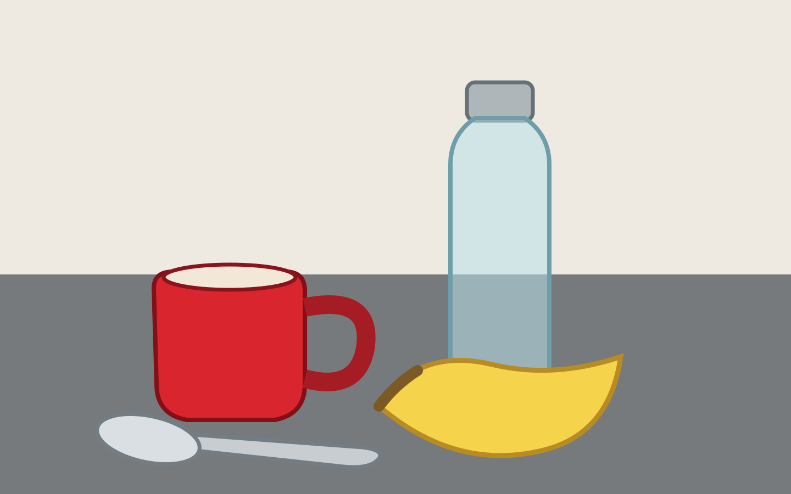

# 18 — Image Annotation and Visual Quality Review

**Status: completed self-directed synthetic practice sample**

## Source and task

The included `sample-scene.svg` is an original vector illustration created for this exercise, not a third-party photograph or dataset asset.

- Source type: original synthetic vector artwork
- Licence: CC0 1.0 dedication for this original portfolio asset
- Dimensions: 1440 × 900 pixels
- Task: object categorisation and axis-aligned bounding-box annotation
- Coordinate convention: absolute pixels, origin at top-left; boxes are [x_min, y_min, x_max, y_max]

## Annotations

| Object ID | Category | Bounding box | Visible attributes | Occlusion | Truncation | Confidence |
|---|---|---:|---|---|---|---:|
| IMG-001 | mug | [276, 478, 683, 769] | red body; light interior; attached handle | none | no | 0.99 |
| IMG-002 | bottle | [816, 146, 1004, 744] | transparent body; silver-coloured cap | none | no | 0.98 |
| IMG-003 | banana | [685, 646, 1135, 865] | yellow peel; brown stem | none | no | 0.98 |
| IMG-004 | spoon | [170, 747, 694, 859] | metallic appearance; bowl and handle | none | no | 0.97 |

Structured version: [annotations.json](annotations.json).

## QA review

- Four visible foreground objects annotated once each.
- Bounding boxes include the visible object outlines and strokes in the authored SVG, have positive width and height, and remain within the 1440 × 900 image.
- Labels use singular common-object categories.
- Attributes are limited to visible appearance; no identity, intent or hidden properties are inferred.
- No object is materially obscured in this deliberately simple scene.
- Confidence values are author-assigned practice estimates, not calibrated probabilities or independently adjudicated scores.

## Limitations

This is a controlled synthetic vector scene, not a natural-image benchmark. Coordinates were manually defined from the authored vector geometry and have not been independently adjudicated. The sample demonstrates basic object labelling, bounding-box conventions, structured output and a documented QA pass; it does not establish production speed or independent inter-annotator agreement.
